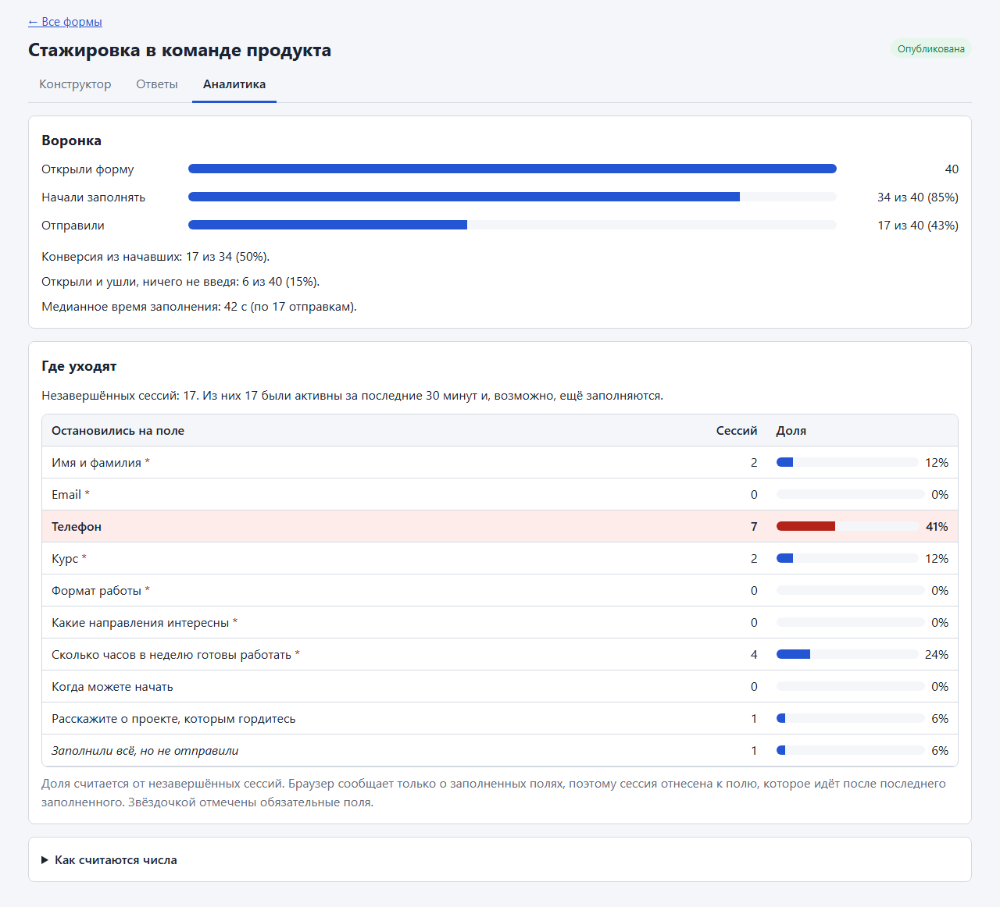
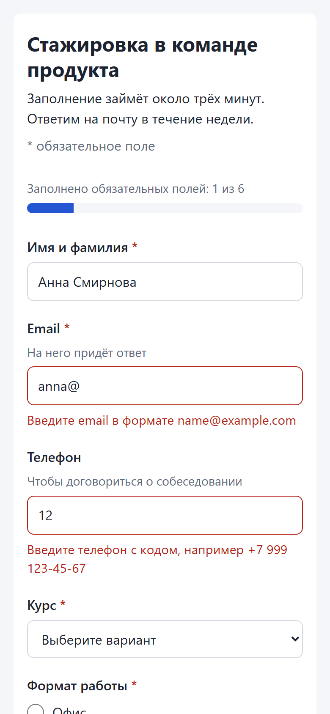
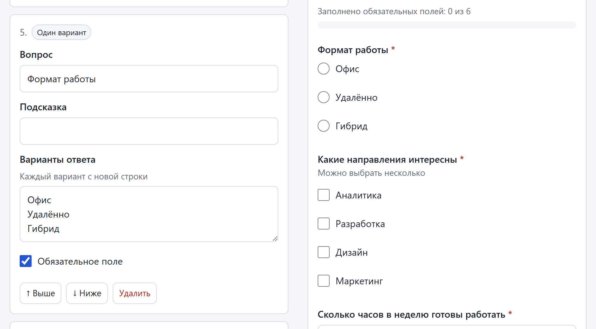
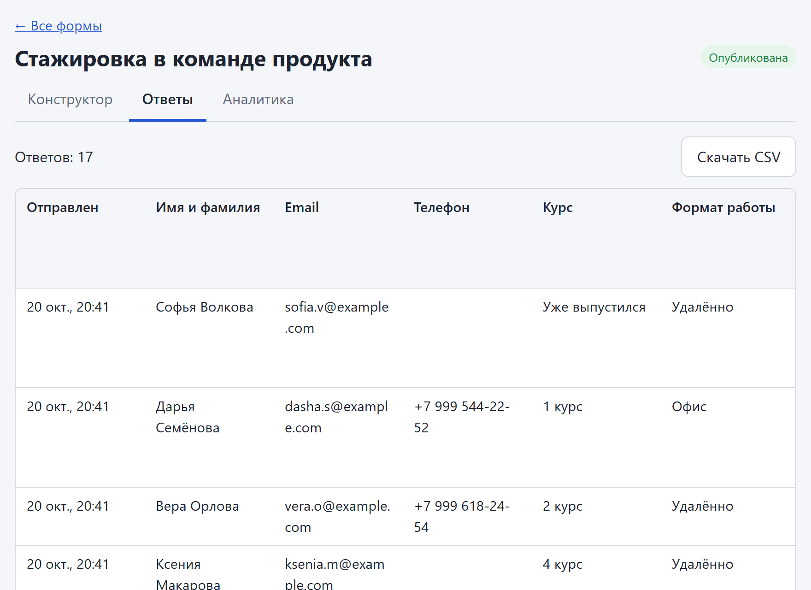

# form-builder

[](https://github.com/alekseevpavel04/form-builder/actions/workflows/ci.yml)

Сервис форм отклика. Менеджер собирает форму в админке и публикует её по ссылке, студент заполняет её с телефона или компьютера, менеджер смотрит ответы и выгружает их в CSV.

Вторая половина задачи касается брошенных форм. На экране аналитики видно, сколько человек открыли форму, сколько начали и отправили, и на каком поле останавливаются те, кто не дошёл до конца. Студенту в это время проще дойти до конца: введённое не пропадает при закрытой вкладке, а прогресс показывает, сколько обязательных полей осталось.

## Как это выглядит

Снято на демо-форме, которую сервер создаёт при первом старте. Данные ненастоящие. Перед съёмкой через тот же API, которым пользуется страница студента, прошли 40 сессий с паузами между полями, 17 из них отправили ответ. На каком поле бросать, задано заранее, а время заполнения настоящее. Сессии шли за пару минут до снимка, поэтому все незавершённые помечены как активные за последние 30 минут.

Аналитика. Больше всего незавершённых сессий, 7 из 17, остановились на необязательном поле «Телефон».



Страница студента на телефоне шириной 390 px. Ошибки показаны у полей, прогресс считает только заполненные без ошибок обязательные поля.



Конструктор с превью, которое рисуется тем же кодом, что и страница студента.



Ответы в таблице и выгрузка в CSV.



## Запуск

Нужен Node.js 20 или новее. Зависимостей и шага сборки нет.

```
npm install
npm start
```

Админка откроется на http://localhost:3000/admin, без входа. При первом старте сервер создаёт папку `data/` и демо-форму.

Другой порт задаётся переменной `PORT`:

```
PORT=4000 npm start            # bash, macOS, Linux
$env:PORT=4000; npm start      # PowerShell
```

С телефона в той же сети форма открывается по адресу компьютера, например `http://192.168.1.20:3000/f/<id>`. Windows при первом запуске может спросить, пускать ли Node.js в сеть.

## Что сделано

- **Конструктор.** Девять типов полей: короткий и длинный текст, email, телефон, число, дата, один вариант, несколько вариантов, выпадающий список. У поля есть вопрос, подсказка и обязательность, у полей с выбором ещё варианты. Порядок меняется кнопками «Выше» и «Ниже». Превью рядом рисуется тем же кодом, что и страница студента.
- **Публикация.** Форма получает ссылку `/f/<id>` с кнопкой копирования. Снятая с публикации форма показывает студенту страницу «Форма закрыта», и сервер не принимает в неё ответы, даже из уже открытой вкладки. Черновик и несуществующая ссылка дают «Форма не найдена».
- **Страница студента.** Ошибка показывается у поля, по-русски и с примером («Введите телефон с кодом, например +7 999 123-45-67»). Сервер проверяет ответ по тем же правилам и возвращает ошибку по id поля, она встаёт под нужным полем. При отправке с ошибками фокус переходит на первое такое поле. На телефоне нет горизонтальной прокрутки, у полей нужная клавиатура и шрифт 16px, чтобы iOS не увеличивал страницу.
- **Черновик и прогресс.** Введённое сохраняется в localStorage браузера и возвращается после перезагрузки или повторного открытия ссылки, после отправки стирается. Полоса прогресса считает обязательные поля, которые заполнены и прошли проверку.
- **Копия формы.** Кнопка «Сделать копию» в списке форм создаёт черновик с новой ссылкой и названием «Копия: ...». Ответы и события остаются у исходной формы.
- **Ответы.** Таблица в админке и CSV, который русский Excel открывает двойным щелчком.
- **Аналитика.** Воронка «открыли, начали, отправили» с конверсией в виде «1 из 3 (33%)», медианное время заполнения, таблица «где уходят» по всем полям в порядке формы. У каждого поля рядом видно, в скольких сессиях на нём показали ошибку и какую, и сколько времени на нём проводят. Как считается каждое число, написано на том же экране.

## Что собирает аналитика

Случайный id сессии, который браузер хранит в localStorage, тип события (`view`, `start`, `field_completed`, `field_error`, `field_time`, `submit`), id поля для событий поля, вид ошибки для `field_error` (пусто, формат, вариант не из списка), время на поле в миллисекундах для `field_time` и время приёма на сервере. Содержимое полей, текст ошибки, нажатия клавиш, IP и user agent не собираются.

## Как считается «где уходят»

Браузер не сообщает, на каком поле человек закрыл вкладку. Известно только, какие поля он заполнил: событие `field_completed` уходит, когда человек покидает поле, а значение в нём проходит проверку. Поэтому незавершённая сессия попадает на поле, которое идёт после самого дальнего заполненного. Если заполнены все поля, сессия попадает в строку «Заполнили всё, но не отправили». На экране это подписано.

Само место ещё не говорит, почему человек ушёл. Для этого у каждого поля есть две колонки.

- **Ошибки.** Когда у поля показывается ошибка, браузер отправляет `field_error` с её видом: пусто, формат или вариант не из списка. Колонка показывает, в скольких сессиях у поля была ошибка, из тех, что до него дошли, например «5 из 21», и под числом виды ошибок. Повтор той же ошибки в той же сессии не считается. Ошибка, которая мелькает, пока человек исправляет поле, не отправляется: стереть поле, чтобы набрать заново, не значит оставить его пустым. Считаются все сессии, и отправившие, и ушедшие, потому что поле, на котором спотыкаются дошедшие до конца, объясняет и тех, кто ушёл.
- **Время на поле.** Это медиана от входа в поле до ухода из него, при первом заходе в сессии. Уходом считается и скрытая вкладка: на телефоне вкладку обычно закрывают, не уходя с поля, а время на брошенном поле важнее всего.

Остальные определения:

- Всё считается по сессиям. Сессия здесь означает один браузер. Перезагрузка и повторный переход по ссылке не добавляют просмотр, после отправки начинается новая сессия.
- `submit` записывает сервер в момент, когда принял ответ. Событие из браузера терялось бы, если вкладку закрыли сразу после отправки.
- События уходят через `navigator.sendBeacon`. Так они не мешают вводу и доходят, даже когда вкладку закрывают.
- Медиана берётся по времени от первого ввода до отправки. Среднее портит одна вкладка, забытая на ночь.
- Тот, кто заполняет прямо сейчас, тоже выглядит незавершённым. Отдельной строкой показано, сколько незавершённых сессий были активны за последние 30 минут. Исключать их порогом я не стал, иначе форма, брошенная минуту назад, пропала бы из таблицы.

## Ключевые решения

- **Без зависимостей.** Сервер написан на `node:http`, данные лежат в JSON-файлах в `data/`. `npm install` нечему ломать на чистой машине, а данные можно открыть глазами. Платить за это приходится тем, что файл переписывается целиком при каждой записи. До тысяч ответов это незаметно.
- **Одна схема правил.** Проверка ответа лежит в `public/shared/schema.js`, и этот модуль импортируют и сервер, и браузер. Браузер показывает ошибку до отправки, сервер проверяет каждую отправку заново: обязательность, формат, варианты из списка. Ключи, которых нет в форме, отбрасываются.
- **Запись не теряет данные.** Файл пишется во временный и переименовывается поверх старого, записи в один файл идут по очереди. Тест убивает процесс посреди потока записей и проверяет, что каждый подтверждённый ответ остался на диске.
- **Ссылка случайная.** Это 8 символов без похожих букв и цифр. Название формы на кириллице может поменяться после публикации, а ссылку черновика не должно быть легко угадать.
- **Правка формы с ответами разрешена.** Ответы хранятся по id поля, поэтому переименование и перестановка их не ломают. У удалённого поля колонка остаётся в таблице и CSV с пометкой «поле удалено». Тип существующего поля поменять нельзя, старые ответы перестали бы ему соответствовать.
- **Повторная отправка.** Ответ уходит вместе с id сессии, и второй ответ с тем же id не сохраняется. Двойной щелчок даёт один ответ.
- **Число.** Поле числа сделано через `input type=text` с `inputmode=decimal`. С `type=number` часть браузеров не принимает «3,5» и отдаёт пустую строку.
- **CSV.** Файл в UTF-8 с BOM, разделитель `;`, переводы строк CRLF. Несколько вариантов попадают в одну ячейку через `; `. Ячейка, которая начинается с `=`, `+`, `-` или `@`, получает апостроф, чтобы Excel не принял её за формулу.

## Что сознательно не делал

- **Авторизации нет**, так в ТЗ. Поэтому любой, кто видит сервер, может зайти в админку. Запускать стоит только в доверенной сети.
- Перетаскивание полей мышью, аккаунты, уведомления, мультиязычность, фильтры в таблице ответов.
- Ограничения частоты событий. На одну сессию сервер пишет не больше одного события каждого вида на поле, но новые id сессий никто не ограничивает.

## Ограничения

- Черновик живёт в localStorage до отправки. На общем компьютере следующий человек увидит недописанную форму.
- Если браузер не даёт писать в localStorage (часть приватных режимов), форма работает, но каждая перезагрузка считается новой сессией, а черновик не сохраняется.
- Ответ, отправленный напрямую через API без id сессии, есть в таблице, но не в воронке.
- Время на поле считается только за первый заход. Тот, кто вернулся исправить поле, добавляет ошибку, но не время. По MDN Safari не ставит фокус на флажок и переключатель по щелчку, поэтому у полей с вариантами время может не прийти, и в колонке тогда стоит «нет данных». В Safari я это не проверял.
- Ошибки, которые вернул сервер, а не проверка в браузере, в аналитику не попадают. Правила у них общие, так что расхождение бывает, только если форму поменяли, пока студент её заполнял.
- Время в CSV пишется по часам сервера. Телефон `+7...` в Excel показывается с апострофом, это цена защиты от формул.

## Тесты

```
npm test
```

Тесты написаны на `node:test`. Unit-тесты проверяют правила для всех 9 типов полей и грязный ввод. Интеграционные тесты поднимают сервер на свободном порту с данными во временной папке и ходят в него по HTTP. Они покрывают создание и публикацию формы, отправку и ошибки по полям, закрытую форму, CSV, события, все числа аналитики (сверены с ручным подсчётом), старт на занятом порту, повреждённый файл данных и убитый процесс. CI гоняет `npm test` и `npm start` с `PORT` на Linux, Windows и macOS с Node 20, 22 и 24.

Раскладка кода и правила для работы над проектом описаны в [CLAUDE.md](CLAUDE.md).

## Инструменты

Все решения принимал я, процесс контролировал я, за результат отвечаю я. Claude Code использовался как инструмент для кода.
